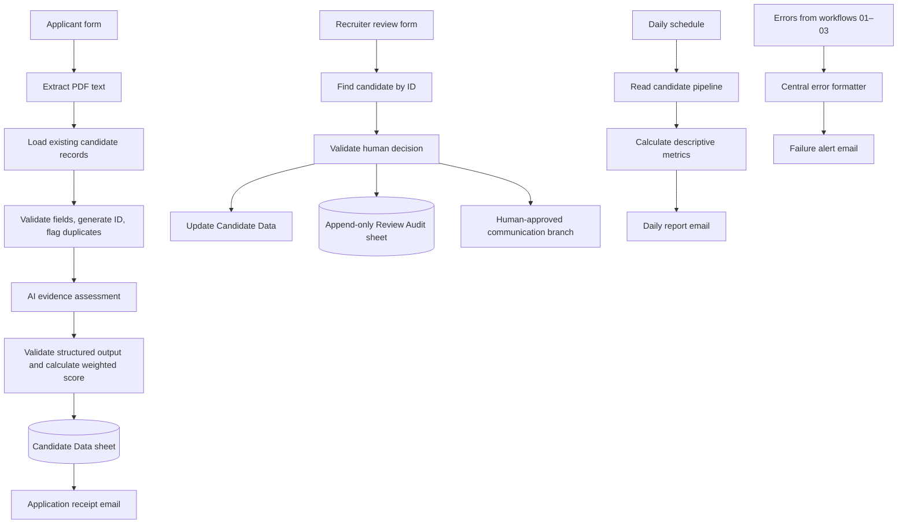

# Workflow architecture

## Data stores

- **Candidate Data:** one row per application, including assessment evidence, score, duplicate flag, current status, and latest human review fields.
- **Review Audit:** one appended event per recruiter decision, preserving the prior and new status, decision, reviewer, notes, and timestamp.

## Assessment score

The Code node calculates the weighted score after validating five integer ratings from 0–5:

| Criterion | Weight |
|---|---:|
| Essential skills | 35% |
| Relevant experience | 25% |
| Role qualifications | 20% |
| Evidence quality | 10% |
| Preferred skills | 10% |

The weighted result is scaled to 0–100. It is an advisory summary of evidence found in the submitted document, not a hiring decision or predictive probability.

## Trust boundaries

- Applicant-provided résumé text and job descriptions are untrusted input.
- AI output is untrusted until parsed and validated by the downstream Code node.
- Recruiter decisions are explicit inputs to the review workflow.
- Credentials and access permissions are configured in the user's n8n workspace and are not stored in this repository.
- Error notifications intentionally exclude résumé contents.
